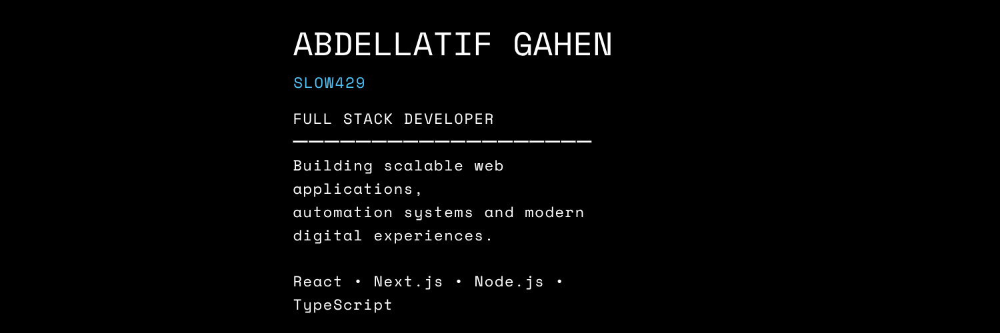

  

<h1 align="center">Hi 👋, I'm Abdellatif</h1>

<h3 align="center">
Full Stack Developer • React • Next.js • Node.js • Discord Bots
</h3>

I enjoy building modern web applications, automation tools, and scalable Discord bots.

---

##  About Me

-  Full Stack Developer
-  Passionate about Web Development & Automation
-  Building Discord Bots & HR Systems
-  Always learning new technologies

---

#  Tech Stack

### Frontend
- HTML5
- CSS3
- JavaScript (ES6+)
- TypeScript
- React.js
- Next.js
- Tailwind CSS

### Backend
- Node.js
- Express.js
- REST API

### Database
- MongoDB
- MySQL

### Other
- Git
- GitHub
- Discord.js
- C++

---

#  Featured Project

##  Q Smart Technology

Official E-Commerce Website designed and developed for **Q Smart Technology**.

### 🔗 Live Website

https://qsmart-store.com/en

### Highlights

- Modern UI/UX
- Responsive Design
- Product Catalog
- Shopping Cart
- Category Management
- Fast Performance
- Multi-language Support

---

#  Featured Repositories

##  Personal Portfolio
🔗 https://github.com/SLOW429/personal-site

Personal portfolio website showcasing my work and experience.

---

##  GLU (Work in Progress)

🔗 https://github.com/SLOW429/GLU

Currently under active development.

---

##  V3 HR BOT

🔗 https://github.com/SLOW429/V3.0-HR-BOT

Advanced HR Discord bot with improved features.

---

##  HR BOT

🔗 https://github.com/SLOW429/HR-BOT

Discord HR management bot.

---

##  Discord Bot

🔗 https://github.com/SLOW429/discord-bot

Multipurpose Discord bot.

---

##  HR Welcome Bot

🔗 https://github.com/SLOW429/HR-WELLCOME-bot

Automated welcome system for HR Discord servers.

---

#  Current Focus

-  Full Stack Applications
-  Performance Optimization
-  Discord Automation
-  Cloud Deployment

---

#  Contact

GitHub:
https://github.com/SLOW429

Website:
https://qsmart-store.com/en

---

 Thanks for visiting my profile!
